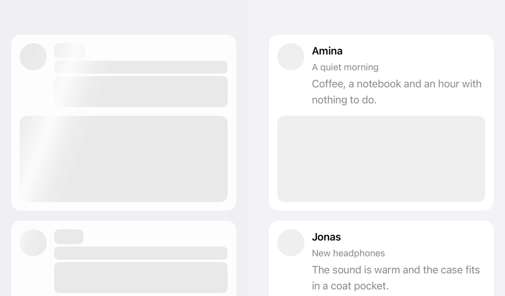

# Skeletons

Loading placeholders for UIKit. Grey blocks stand in for a screen's content while it loads, with one
light band sweeping across them.


```swift
import Skeletons

let skeleton = makeFeed(posts: Post.samples).skeletonized()
```

That is the whole setup. Build the screen's content with the function it already uses, pass sample
data, and call `skeletonized()`. Every block lands where the content will.

Skeletonize the whole area that loads, once. A list filled with a few sample items gives one
skeleton; its cards are not each skeletonized on their own.



## Install

In `Package.swift`:

```swift
.package(url: "https://github.com/maazsurti/Skeletons.git", from: "1.5.0")
```

In Xcode: **File → Add Package Dependencies…**, paste the URL, and set the rule to *Up to Next
Major*. The product is **`Skeletons`**.

iOS 17+, Swift 6 tools.

## Show it on a whole screen


A feed screen builds its rows with one function. While the posts load it passes sample posts and
skeletonizes the result. When they arrive it passes the real posts instead.

```swift
import Skeletons
import UIKit

struct Post {
    let author, title, body: String
    static let samples = [
        Post(author: "Amina", title: "A quiet morning", body: "Coffee and an hour to spare."),
        Post(author: "Jonas", title: "New headphones", body: "Warm sound, a small case."),
        Post(author: "Priya", title: "Back from the coast", body: "Three days of wind."),
    ]
}

final class FeedViewController: UIViewController {

    private let host = UIView()   // the app's scroll view content
    private let content = UIView()
    private var switcher: SkeletonSwitcher?
    private let service = PostService()

    override func viewDidLoad() {
        super.viewDidLoad()
        pin(content, in: host)
        load()
    }

    func load() {
        let skeleton = makeFeed(posts: Post.samples).skeletonized()   // the package call
        pin(skeleton, in: host)
        switcher = SkeletonSwitcher(skeleton: skeleton, content: content)
        switcher?.startLoading()                                      // the package times it

        service.fetch { [weak self] result in
            guard let self else { return }
            switch result {
            case .success(let posts):
                self.pin(self.makeFeed(posts: posts), in: self.content)
                self.switcher?.showContent()                          // fade the feed in
            case .failure(let error):
                self.showRetry(for: error)                            // error plus a retry button
            }
        }
    }

    func makeFeed(posts: [Post]) -> UIStackView {
        let feed = UIStackView(arrangedSubviews: posts.map { PostRow(post: $0) })
        feed.axis = .vertical
        feed.spacing = 16
        return feed
    }
}
```

`PostRow` is the app's row: an avatar, a name, two lines of text and a photo. `pin(_:in:)` adds a
view and pins its edges. `PostService` is the app's own fetch. `showRetry(for:)` shows an error with
a retry button that calls `load()` again.

You get these without writing anything else:

- Every block shimmers.
- A load that finishes inside 150 ms shows the content with no skeleton.
- A skeleton that appears stays at least 300 ms.
- The skeleton fades into the content over 200 ms.
- VoiceOver reads the skeleton as one "Loading" element.
- Reduce Motion swaps the sweep for a pulse.
- Right-to-left layouts sweep from the trailing edge.

The view you pass to `skeletonized()` is used up by the skeleton, so build a new one for each load.
Never pass the live view.

The demo app runs this screen: sample posts skeletonized, then the real feed after a simulated fetch.

## What turns into a block

`skeletonized()` turns each view that will hold fetched content into a same-size grey block:

- A label becomes a bar at its width and line height. Several lines become one block.
- An image view becomes a block at its corner radius.
- A button, switch or slider becomes one block.
- A text field keeps its surface, border and corners. Only its value line shimmers.
- A search field stays real.
- A view with a background, border or shadow becomes one block. If it holds more than one item and
  has no fixed size, each item becomes a block instead.
- A separator under 2 pt stays real.

Labels and buttons count as fetched content. Keep the screen's own copy — titles, headings, field
labels, chips, action buttons — with these lists:

```swift
let skeleton = makeFeed(posts: Post.samples).skeletonized(
    keeping: [titleLabel, retryButton],
    ignoring: [divider]
)
```

- `only` — skeletonize these views only. Everything else stays real.
- `keeping` — these views stay real and in place.
- `ignoring` — these views keep their space and show nothing.

One view can set its own mode with `skeletonMode(_:)`: `.automatic`, `.block`, `.static` or
`.ignored`. A mode set on a view applies to the views inside it too, unless one of them sets its
own. `Skeletonized { view }` follows the same rules inside a layout.

## Build one by hand

When no real view has the shape you need, declare it. Spacing, radii and line heights come from the
theme:

```swift
let skeleton = SkeletonLayout {
    SkeletonLine(.title)
    SkeletonCard(padding: 14) {
        SkeletonRow(spacing: 14) {
            SkeletonPhoto(width: 84, height: 64, radius: 12)
            SkeletonColumn(spacing: 2) {
                SkeletonLine(.headline, widthFraction: 0.6)
                SkeletonLine(.body, widthFraction: 0.9)
            }
        }
    }
    SkeletonRows(count: 5, .listRow, spacing: 12)
}.makeView()
```

- `SkeletonLayout`, `SkeletonColumn`, `SkeletonRow` — the root, a column and a row. Each takes
  `spacing`, `padding` and `alignment`.
- `SkeletonLine(.title)` — one line of text, in `.title`, `.headline`, `.body`, `.caption` or
  `.custom(size)`.
- `SkeletonBlock`, `SkeletonPhoto`, `SkeletonCircle` — a rectangle, a photo, a circle.
- `SkeletonCard` — a card's background, border, radius and padding around its blocks.
- `SkeletonField`, `SkeletonPickerRow` — a loading text field or picker, with the real label and
  chevron. Only the value area shimmers.
- `SkeletonRows(count:)` — one row, repeated.
- `SkeletonSpacer()` — the spare width in a row.
- `SkeletonReal(view)` — a real view inside the shape.
- `.width`, `.height`, `.widthFraction`, `.padding`, `.aspect`, `.hugging`, `.radius` — size a block.

Lines with no gap between them in a `spacing: 0` column join into one rectangle with rounded outer
corners. Any gap keeps them apart. Blocks placed by hand come last:

```swift
let layout = UIStackView(arrangedSubviews: [
    SkeletonView.circle(diameter: 40),
    SkeletonView.line(height: 16, widthFraction: 0.6),
    SkeletonView.block(height: 72),
])
layout.axis = .vertical
layout.spacing = 12

let skeleton = SkeletonContainerView(content: layout)
```

## Make it yours

Every value has a default, so `SkeletonTheme()` is complete. Set the theme once at launch, beside
the rest of the app's theming:

```swift
SkeletonTheme.current = SkeletonTheme(
    base: SkeletonTheme.defaultBase,
    highlight: SkeletonTheme.defaultHighlight
)
```

`base` and `highlight` are the block and band colours; both defaults follow light and dark mode.
`cornerRadius` defaults to 8. A loading field takes its surface, border, text colour, font, height,
radius and padding from the same theme.

### Timing

`shimmerDuration` is the time one sweep takes (1.7 s). `shimmerMinRest` is the pause with the band
off screen between sweeps (0.25 s). `shimmerStagger` sets how far apart neighbouring cards sweep
(0.1 s). Zero sweeps them together.

```swift
SkeletonTheme.current = SkeletonTheme(shimmerDuration: 2.0, shimmerMinRest: 0.4)
```

### One line across the screen

By default each card or section sweeps on its own, a little after the one above it.
`shimmerAlignment: .window` lines every skeleton on the screen up instead, so one band crosses cards,
sections and separate skeletons as a single continuous stripe.

```swift
SkeletonTheme.current = SkeletonTheme(shimmerAlignment: .window)
```

### The stripe's angle

`shimmerAngle` leans the stripe, in degrees from vertical. `0` draws an upright band, `20` is the
default, `45` is a steep diagonal, and a negative value leans the other way. Anything past 80° either
side is capped at 80°. Right-to-left layouts mirror it, whichever angle you set.

```swift
SkeletonTheme.current = SkeletonTheme(shimmerAngle: 30)
```

### Right to left

`isRightToLeft` decides the direction of the sweep. Point it at the app's own language state:

```swift
SkeletonTheme.current = SkeletonTheme(
    isRightToLeft: { UIApplication.shared.userInterfaceLayoutDirection == .rightToLeft }
)
```

## Try the demo

`Demo/` holds a small UIKit app that runs the screen above: sample posts skeletonized, a simulated
two-second fetch, then the real feed. It also has the theme controls the later sections describe.

Open `Demo/SkeletonsDemo.xcodeproj` in Xcode and run it; it builds against this package by relative
path.

## Contributing

Adding or changing a skeleton in an app: read [`AGENTS.md`](./AGENTS.md) first.

`Tests/SkeletonsTests/` runs with
`xcodebuild test -scheme Skeletons -destination 'platform=iOS Simulator,id=<udid>'`.
