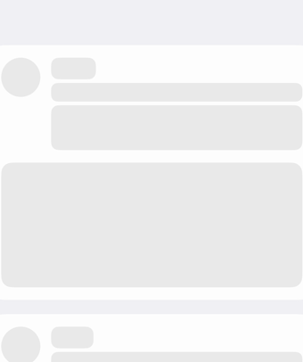
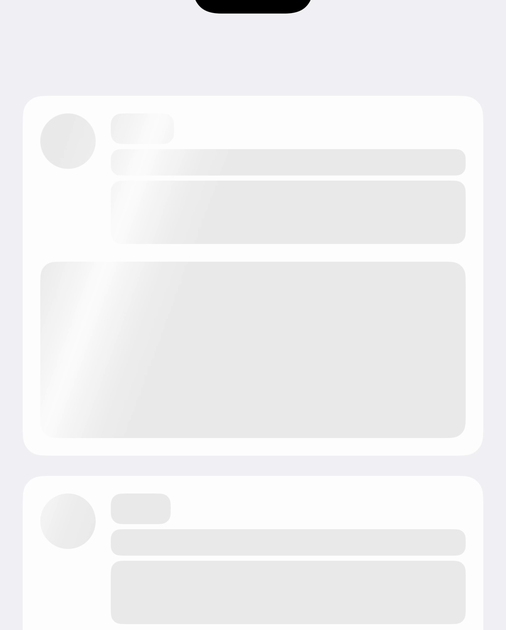

# Skeletons

Loading placeholders for UIKit: grey blocks laid out like the screen's content, with one shimmer
band crossing them while a request is in flight.



```swift
import Skeletons

let skeleton = OrderCardView(order: .sample).skeletonized()
```

That is the whole setup. `skeletonized()` reads a real view filled with sample data and stands in
for it, so each block lands where the content will. Every block shimmers, the screen reads as one
VoiceOver "Loading" element, Reduce Motion swaps the sweep for a pulse, and right-to-left layouts
sweep from the trailing edge.


## Install

In `Package.swift`:

```swift
.package(url: "https://github.com/maazsurti/Skeletons.git", from: "1.5.0")
```

In Xcode: **File → Add Package Dependencies…**, paste the URL, and set the rule to *Up to Next
Major*. The product is **`Skeletons`**.

iOS 17+, Swift 6 tools.

## Show it while a screen loads



Build the view as the loaded screen builds it, fill it with sample data, skeletonize it, and hand
both views to a switcher placed in the same frame:

```swift
let skeleton = OrderCardView(order: .sample).skeletonized()
let switcher = SkeletonSwitcher(skeleton: skeleton, content: contentView)

func load() {
    switcher.startLoading()
    service.fetch { [weak self] result in
        self?.apply(result)
        self?.switcher.showContent()
    }
}
```

A load that finishes inside 150 ms shows the content with no skeleton at all. One that takes longer
shows the skeleton for at least 300 ms, then cross-dissolves into the content over 200 ms.

The view passed to `skeletonized()` is a throwaway template: it is reparented into the skeleton and
altered. Never pass the live view.

## What turns into a block

`skeletonized()` looks at every view in the template and swaps the ones that will hold fetched
content for a grey block of the same size:

- A label becomes a bar at its own width and line box; a multi-line label becomes one block.
- An image view becomes a block at its corner radius.
- A button, switch or slider becomes one block.
- A text field keeps its chrome and shimmers one value line; a search field stays real.
- A view with a background, border or shadow keeps it, and the views inside it are handled the same way.
- A separator under 2 pt stays real.

Labels and buttons count as fetched content, so keep the screen's own copy — titles, headings,
field labels, chips, action buttons:

```swift
let card = OrderCardView(order: .sample)
let skeleton = card.skeletonized(
    only: [card.sections],
    keeping: [card.heading, card.actionButton],
    ignoring: [card.badge]
)
```

- `only` — skeletonize these views and leave the rest real.
- `keeping` — these views stay real, in place.
- `ignoring` — these views keep their space and draw nothing.

A view can state the same thing for itself with `skeletonMode(_:)`: `.automatic`, `.block`,
`.static` or `.ignored`. The innermost stated mode wins. `Skeletonized { view }` runs the same rules
inside a layout.

## Build one by hand

When no real view expresses the shape, declare it. Spacing, radii and line heights come from the
theme:

```swift
let skeleton = SkeletonLayout {
    SkeletonLine(.title)
    SkeletonCard(padding: 14) {
        SkeletonRow(spacing: 14) {
            SkeletonPhoto(width: 84, height: 64, radius: 12)
            SkeletonColumn(spacing: 2) {
                SkeletonLine(.headline, widthFraction: 0.6)
                SkeletonLine(.body, widthFraction: 0.9)
            }
        }
    }
    SkeletonRows(count: 5, spacing: 12, .listRow)
}.makeView()
```

- `SkeletonLayout`, `SkeletonColumn`, `SkeletonRow` — the arrangement; each takes `spacing`,
  `padding` and `alignment`.
- `SkeletonLine(.title)` — a text line, in `.title`, `.headline`, `.body`, `.caption` or
  `.custom(size)`.
- `SkeletonBlock`, `SkeletonPhoto`, `SkeletonCircle` — everything else a response fills.
- `SkeletonCard` — a real card's chrome around its content.
- `SkeletonField` and `SkeletonPickerRow` — a loading field or picker: real chrome, label, icon and
  chevron, with only the value area shimmering.
- `SkeletonRows(count:)` — N copies of a preset or a shape written at the call site.
- `SkeletonSpacer()` and `SkeletonReal(view)` — the spare width, and a real view inside the shape.
- Modifiers: `.width`, `.height`, `.widthFraction`, `.padding`, `.aspect`, `.hugging`, `.radius`.

Lines with nothing between them fuse into one rectangle with rounded outer corners, so a column at
`spacing: 0` reads as one surface. A gap of any size keeps them separate.

Blocks placed by hand come last:

```swift
let layout = UIStackView(arrangedSubviews: [
    SkeletonView.circle(diameter: 40),
    SkeletonView.line(height: 16, widthFraction: 0.6),
    SkeletonView.block(height: 72),
])
layout.axis = .vertical
layout.spacing = 12

let skeleton = SkeletonContainerView(content: layout)
```

## Make it yours

Every value has a default, so `SkeletonTheme()` is complete. Set the theme once at launch, beside
the rest of the app's theming:

```swift
SkeletonTheme.current = SkeletonTheme(
    base: .skeletonBase,
    highlight: .skeletonHighlight
)
```

`base` and `highlight` are the block and band colours; both defaults follow light and dark mode.
`cornerRadius` defaults to 8, and a loading field takes its surface, border, text colour, font,
height, radius and padding from the same theme.

### Timing

`shimmerDuration` is one pass (1.7 s), `shimmerMinRest` the pause with the band off screen between
passes (0.25 s), and `shimmerStagger` how far apart neighbouring pieces sweep (0.1 s; zero puts them
back in phase).

```swift
SkeletonTheme.current = SkeletonTheme(shimmerDuration: 2.0, shimmerMinRest: 0.4)
```

### One line across the screen

By default each card or section sweeps on its own, a little after the one above it.
`shimmerAlignment: .window` lines every skeleton on the screen up instead, so one band crosses cards,
sections and separate skeletons as a single continuous stripe.

```swift
SkeletonTheme.current = SkeletonTheme(shimmerAlignment: .window)
```

### The stripe's angle

`shimmerAngle` leans the stripe, in degrees from vertical. `0` draws an upright band, `20` is the
default, `45` is a steep diagonal, and a negative value leans the other way. Anything past 80° either
side is capped at 80°. Right-to-left layouts mirror it, whichever angle you set.

```swift
SkeletonTheme.current = SkeletonTheme(shimmerAngle: 30)
```

### Right to left

`isRightToLeft` decides the direction of the sweep. Point it at the app's own language state:

```swift
SkeletonTheme.current = SkeletonTheme(
    isRightToLeft: { UIApplication.shared.userInterfaceLayoutDirection == .rightToLeft }
)
```

## Try the demo

`Demo/` holds a small UIKit app with a card feed and a loading toggle. Open
`Demo/SkeletonsDemo.xcodeproj` in Xcode and run it; it builds against this package by relative path.

## Contributing

Adding or changing a skeleton in an app: read [`AGENTS.md`](./AGENTS.md) first.

`Tests/SkeletonsTests/` runs with
`xcodebuild test -scheme Skeletons -destination 'platform=iOS Simulator,id=<udid>'`.
